# PotentialBox

A free groovebox for **Windows**, played by the **Arturia BeatStep Pro**. Made by **PotentialBreaks** for my own beat-making and shared for anyone who wants it.

The BeatStep Pro is the sequencer and controller, and PotentialBox makes the sound:

| BeatStep Pro | Plays in PotentialBox |
|---|---|
| **Sequencer 1** (MIDI ch 1) | **Synth 1**: analog-style synth for basslines, acid, leads and chords |
| **Sequencer 2** (MIDI ch 2) | **Synth 2**: wavetable synth with 30 morphing tables |
| **Drum sequencer** (MIDI ch 10) | **Drums**: 16-pad sampler with 9 built-in kits, your own folders and a drum machine library browser |
| **16 knobs** (Control Mode) | The 16 knobs on whichever PotentialBox page is open, including **16 performance macros** |
| **16 pads** (Control Mode, ch 16) | Actions: random sounds, switch pages, next kit and more |

It's pre-wired for the BeatStep Pro's factory settings, so you can plug it in and press play. Every control is a big button you can tap, and everything saves by itself.

**[Download the latest release](../../releases/latest)** · **[Read the manual (PDF)](docs/PotentialBox-Manual.pdf)**

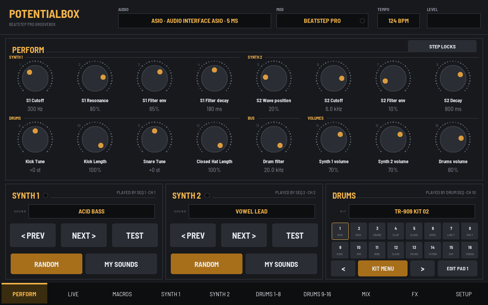

---

## Features

- **Two synths** with resonant filters, envelopes, glide on tied/slid steps, drive and unison
- **Modulation**: on each synth, 2 tempo-syncable LFOs (7 shapes), a mod envelope and 8 mod slots routing LFOs, envelopes, velocity, note or random to pitch, filter, wave position, FM, pan, volume and more
- **Filters and oscillators**: LP 24, LP 12, HP, band-pass and notch with key tracking; Synth 1 adds osc 2 tuning, FM, ring mod, hard sync and noise; both have pitch envelope, analog drift and pan
- **Chord mode**: turn every step into a chord (13 chord types, 3 voicings), even though the BeatStep sequences one note at a time
- **30 wavetables** on Synth 2, including 24 from the free AKWF single-cycle collection
- **Beat generator** (Beats tab): 24 genres (techno, house, UK garage, drum & bass, jungle, dubstep, grime, UK drill, trap, hip hop, boom bap, lo-fi, reggae one drop, steppers, dancehall, reggaeton, afrobeats, breakbeat, electro, disco, funk, footwork and more). One tap for a new take, mutate, busier/simpler, fills, mutes, tap-to-edit grid, and **Send to BeatStep** records the beat straight into the BeatStep's drum sequencer over MIDI. Beats are 1, 2 or 4 bars with an ending that leads back to the top, and **Clock out** makes the BeatStep follow PotentialBox's tempo
- **5-track looper** (Loop tab), inspired by the BOSS RC-505: record your interface's inputs (mic, guitar, keys) and PotentialBox itself, overdub, undo/redo, per-track FX, reverse and half/double speed, loops snapped to the BeatStep's bars and following its Play/Stop, played from the BeatStep's pads, saved as WAV loop sets
- **Arpeggiator** on each synth: 5 patterns, tempo-synced rate, octaves, gate, swing, hold, chance and accents; arpeggiates chord mode
- **Live tab**: 8 hold-to-play punch-in effects (beat repeat, roll, tape stop, reverse, filter sweep, gate, echo throw), Scene A/B with a morph knob and hold-for-B drops, a fill button, and the BeatStep's pads switch to these while the tab is open
- **Step locks**: give any knob its own value on any of the 16 steps, following the BeatStep's clock (like Elektron parameter locks)
- **Drum groove**: per-pad chance and play conditions (fill only, not in fill, 1st of 4 and more), plus per-pad pan
- **Mix**: kick-triggered side-chain ducking (or every beat), 3-band EQ on each synth, the drums and the master, a one-knob glue compressor and stereo width
- **Record to WAV**: the mix plus separate drum, synth and FX stems, 24-bit, into Music > PotentialBox Recordings
- **Resample to a pad**: record half a bar to 4 bars of a synth or the whole mix, in time with the bar, straight onto a drum pad
- **My Setups**: 8 slots that save everything at once (sounds, kit, mix, effects, locks and scenes)
- **Drum sampler**: 9 synthesized kits (808 Boom, 909 Punch, 606 Tight, Trap 808, SP Dust 12-bit, Electro 80s, Minimal Tech, Industrial, Potential), all with the same pad layout so patterns carry over
- **Drum machine library**: point it at a collection of sampled machines (one folder per machine) and browse brand > machine > kit. Sounds are sorted onto the right pads by their file names, and silence at the start of every hit is trimmed
- **Build your own kits**: put any one-shot from your whole collection on any pad, with a random pick per pad type, and save 8 of your own kits
- **16 performance macros**: S1 Sweep, S2 Sweep, Acid, Wobble, Bright, Pluck, Glide, Wide, Dub Throw, Space, DJ Filter, Build-Up, Lo-Fi, Drum Smash, Tighten, Glue. Turn one back to zero and your sound is exactly as it was
- **Effects**: tempo-synced ping-pong delay, reverb, DJ filter and lo-fi crusher
- **Save slots**: 8 sounds per synth, plus Init sounds and Reset All to start fresh
- **Low lag**: ASIO support (your interface's own driver is chosen first), WASAPI exclusive and WASAPI
- Follows the BeatStep Pro's tempo, and Stop sends All Notes Off

| Beats tab | Loop tab | Live tab |
|---|---|---|
| 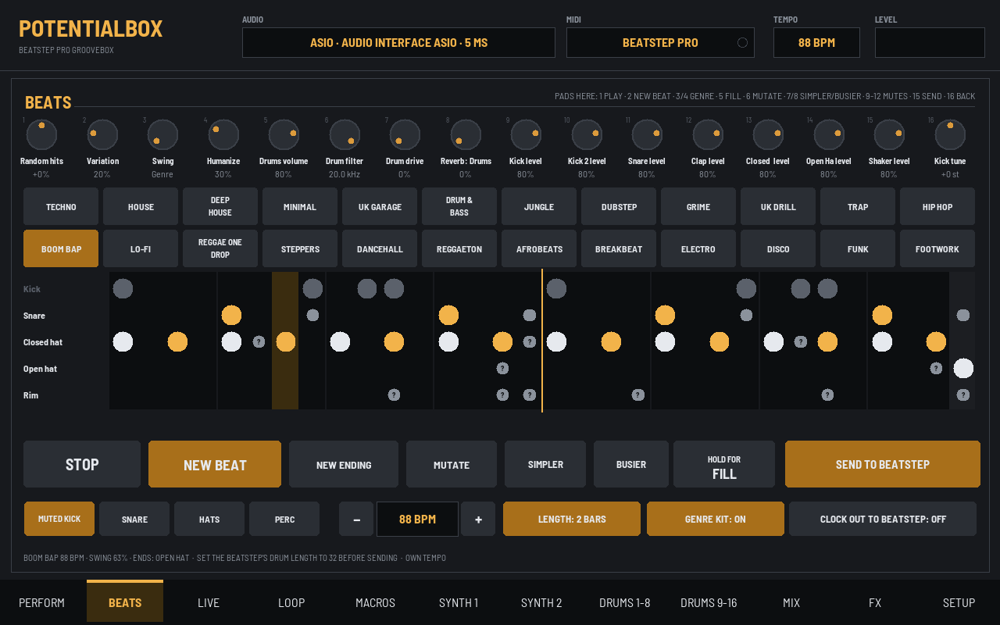 | 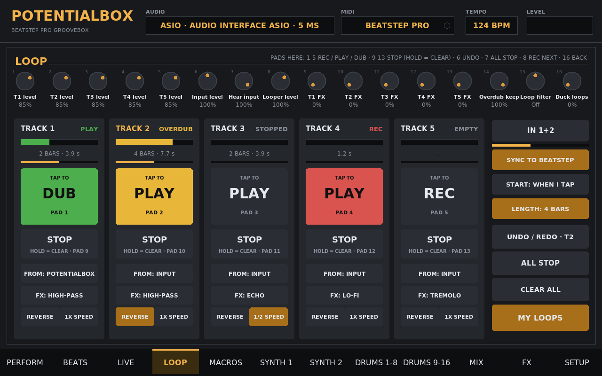 | 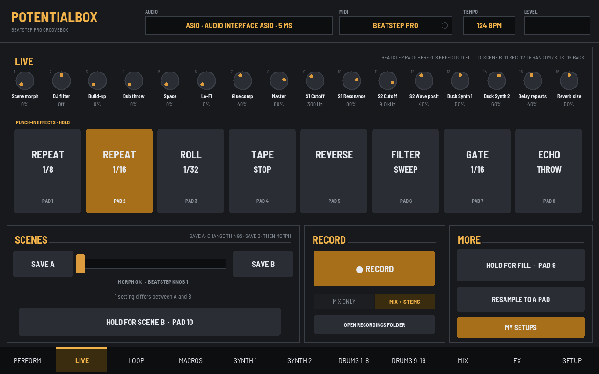 |

| Macros | Synth modulation | Mod routing |
|---|---|---|
| 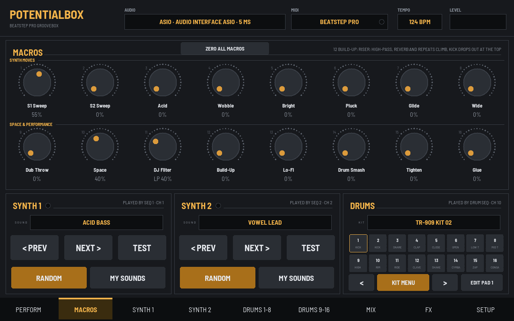 | 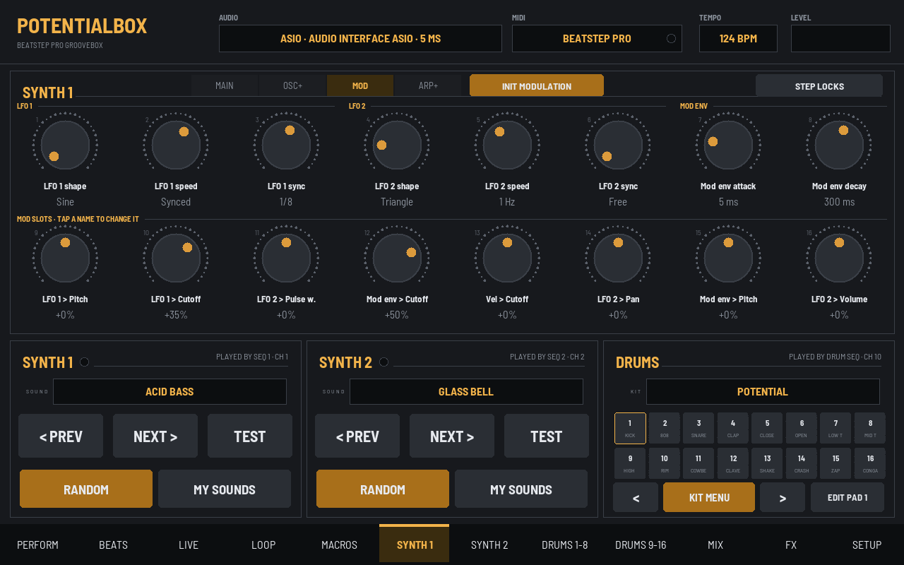 | 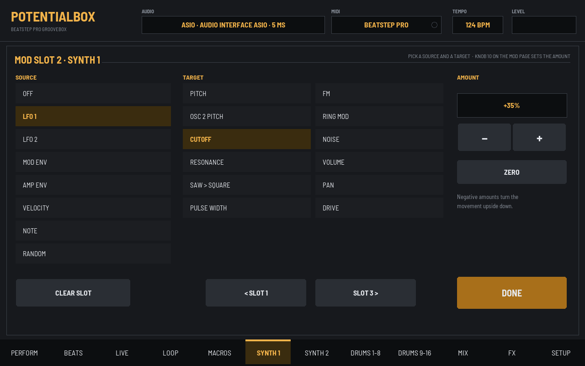 |

| Synth 1 Osc+ | Pad editor | Drum machines |
|---|---|---|
| 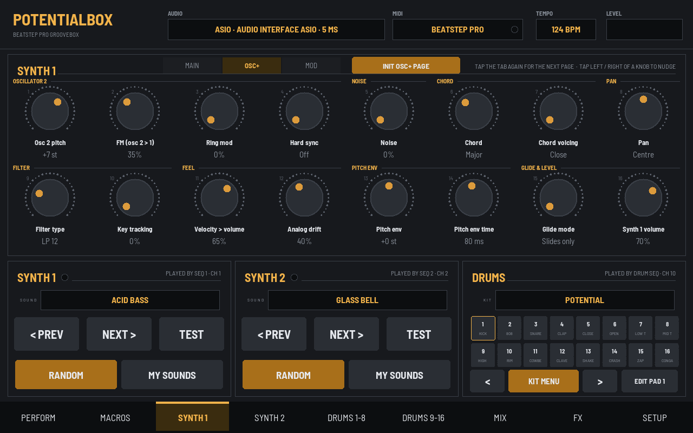 | 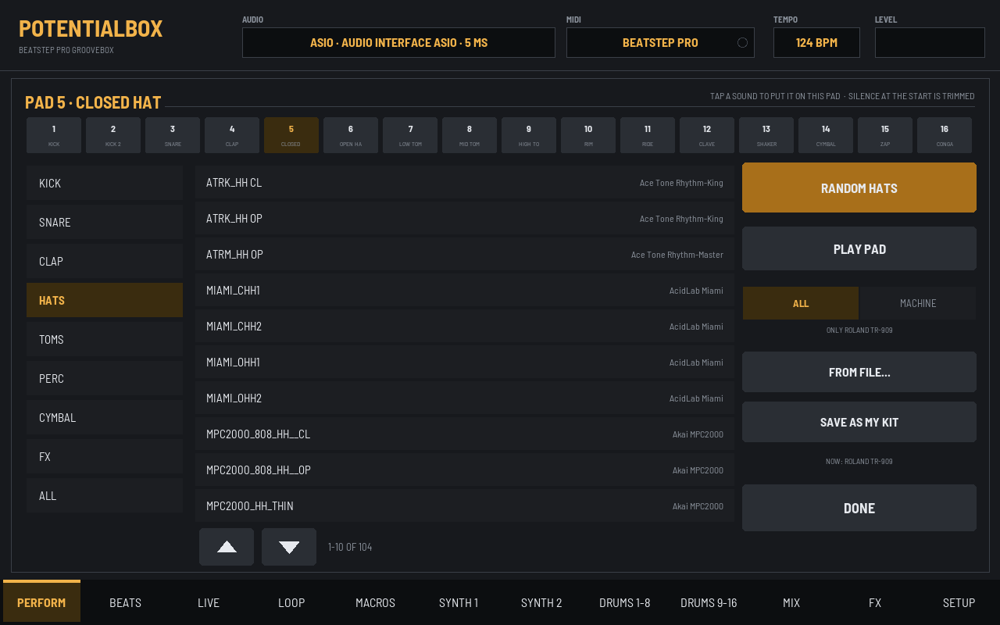 | 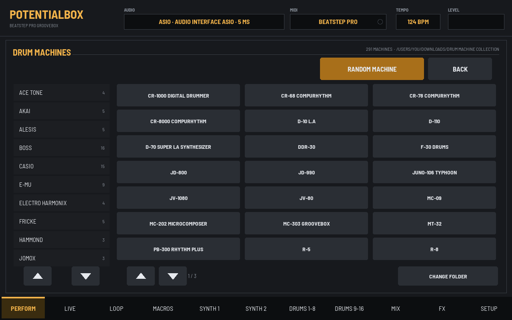 |

---

## Install

You need Windows 10 or 11 (64-bit), a BeatStep Pro on USB, and an internet connection the first time.

1. Download `PotentialBox-<version>-windows.zip` from **[Releases](../../releases/latest)**.
2. Right-click it, choose **Extract All**, and open the **PotentialBox** folder.
3. Double-click **Install PotentialBox.bat**.

The installer sets up a private copy of Python 3.12 and the audio libraries in your user folder (it doesn't touch any other Python you have), adds Desktop and Start menu shortcuts, and starts PotentialBox.

> **"Windows protected your PC"?** PotentialBox is free and not code-signed. Click **More info**, then **Run anyway**.

**Update:** run the new release's installer. Your settings, sounds and kits are kept.
**Uninstall:** right-click `uninstall.ps1` in `%LOCALAPPDATA%\PotentialBox` and choose **Run with PowerShell**.

---

## Quick start with the BeatStep Pro

1. Plug in the BeatStep Pro and start PotentialBox. In **SETUP**, pick your audio output (ASIO is best).
2. Press **PLAY** on the BeatStep Pro. The sequencers play the synths and drums straight away.
3. Press **CONTROL MODE** on the BeatStep Pro to make its 16 knobs control the page you have open.
4. For pad actions, set the BeatStep's Control Mode pads to **MIDI channel 16** in Arturia MIDI Control Center. Pads 1-16 (notes 36-51) then do: Random Synth 1, Random Synth 2, Random Drum Kit, Next Kit, Previous Tab, Next Tab, then the Perform, Synth 1, Synth 2, Drums 1-8, Drums 9-16, Mix and Macros tabs, Synth 1 and 2 Next Sound, and All Notes Off. Re-assign any of them in **SETUP > PAD ACTIONS**.

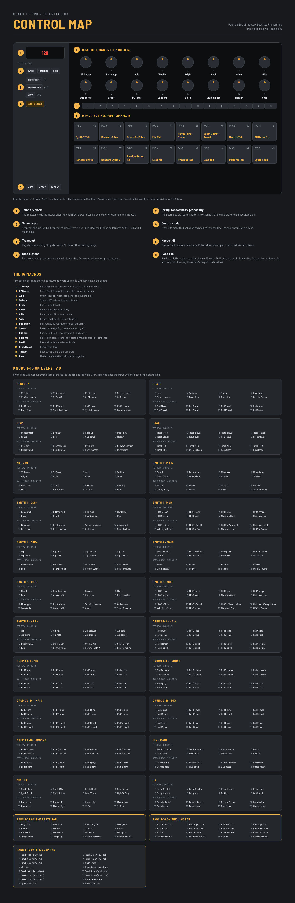

The **[manual](docs/PotentialBox-Manual.pdf)** covers every page, knob and button, plus troubleshooting.

---

## Running from source

PotentialBox is plain Python 3.12 (numpy, scipy, sounddevice, mido, python-rtmidi, tkinter):

```
py -3.12 -m pip install -r requirements.txt
py -3.12 -m potentialbox.app
```

Settings, saved sounds and kits are stored in `%APPDATA%\PotentialBox`.

## Licence

MIT, see [LICENSE](LICENSE). Third-party libraries are listed in [THIRD_PARTY.md](THIRD_PARTY.md).

Arturia and BeatStep Pro are trademarks of Arturia. ASIO is a trademark of Steinberg Media Technologies GmbH. PotentialBox is an independent project and is not affiliated with or endorsed by either.
