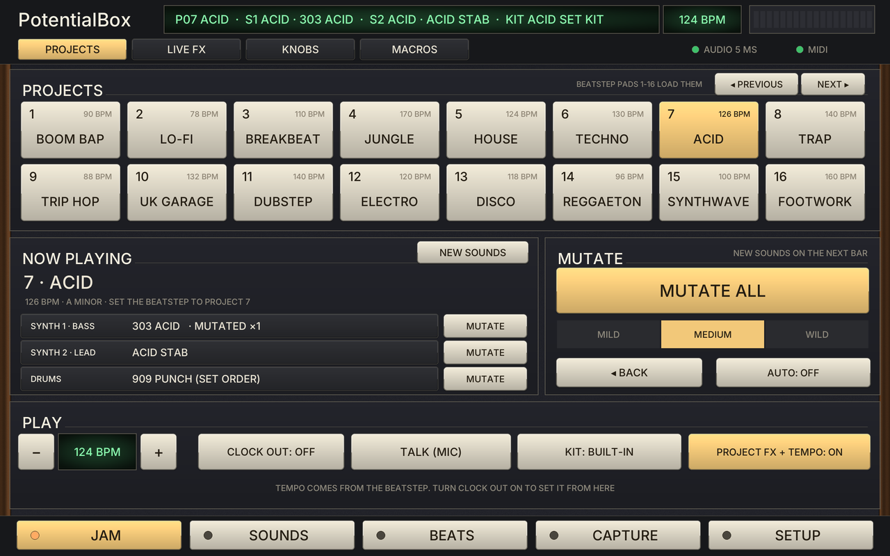
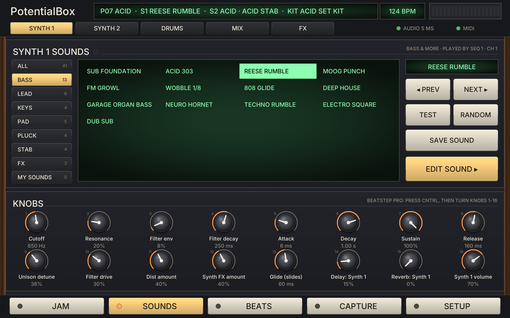
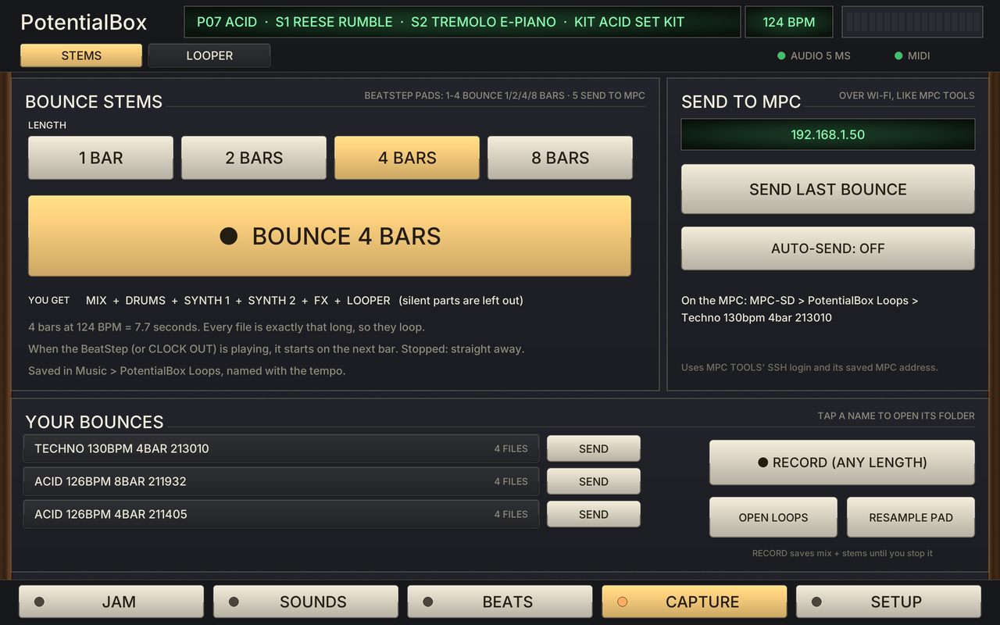
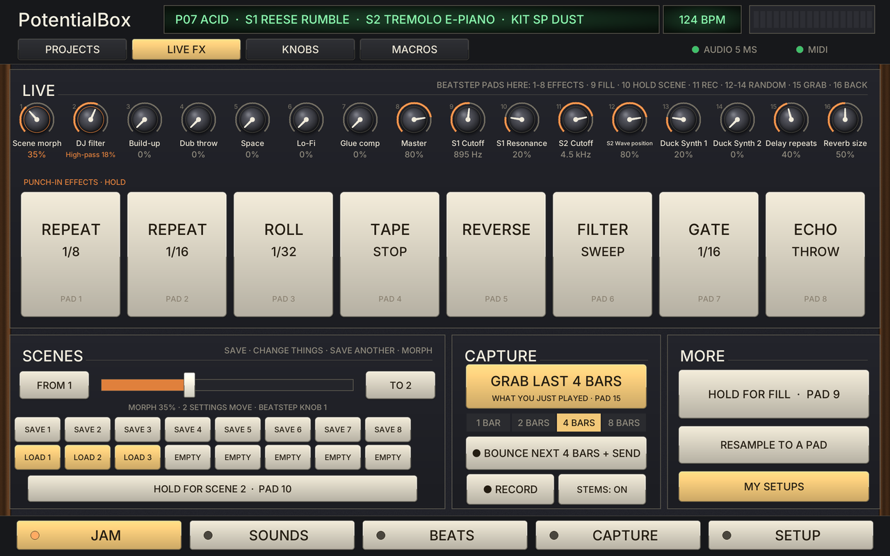
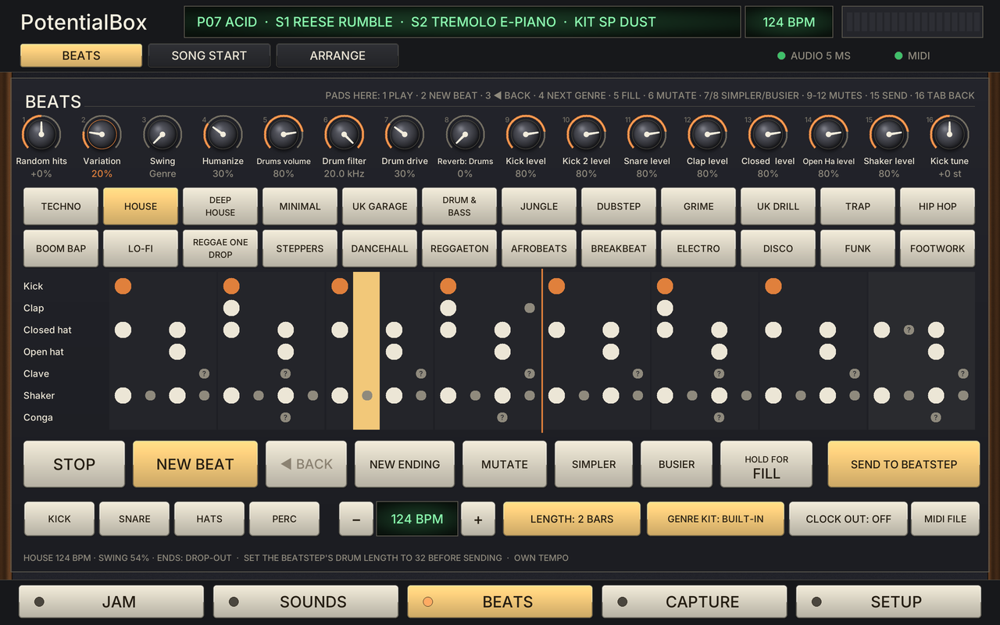
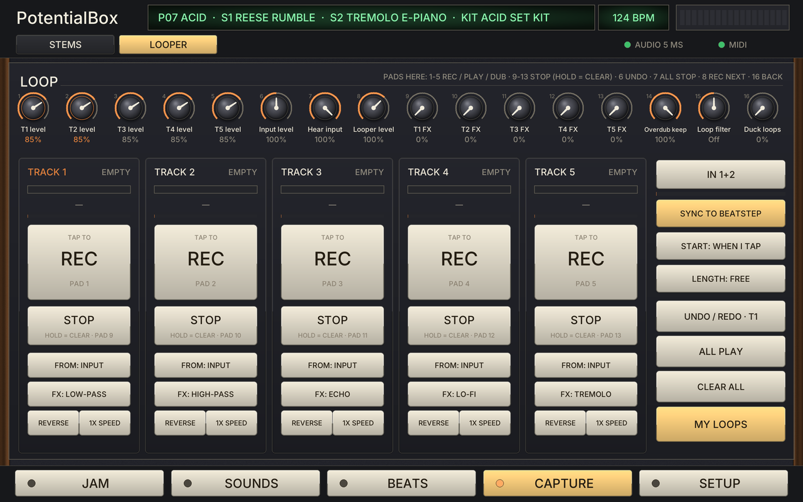
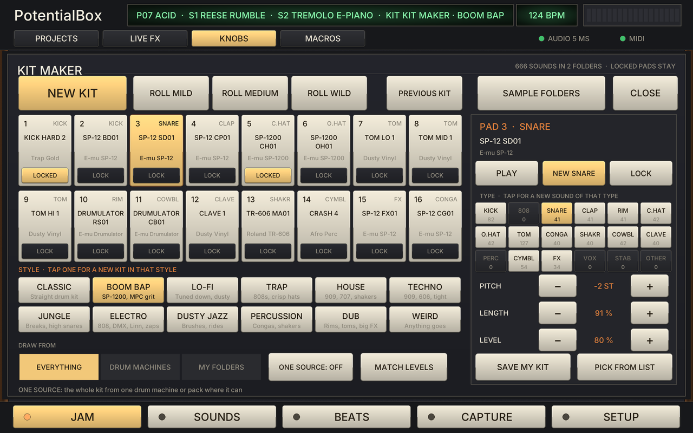

# PotentialBox

A free groovebox for **Windows**, made for **jamming** with the **Arturia BeatStep Pro**, and for catching what you play as loops and stems for your MPC. Made by **PotentialBreaks** for my own beat-making and shared for anyone who wants it.

The BeatStep Pro is the sequencer and controller, and PotentialBox makes the sound:

| BeatStep Pro | Plays in PotentialBox |
|---|---|
| **Sequencer 1** (MIDI ch 1) | **Synth 1**: analog-style synth with unison, supersaw, clean sub, filter drive, distortion and its own effects |
| **Sequencer 2** (MIDI ch 2) | **Synth 2**: wavetable synth with 30 morphing tables and 7 warp modes |
| **Drum sequencer** (MIDI ch 10) | **Drums**: 16-pad sampler with built-in kits, a drum machine library browser and the **Kit Maker** |
| **16 knobs** (Control Mode) | The 16 knobs of whichever screen is open |
| **16 pads** (Control Mode, ch 16) | Actions, or the open screen's own pads (load projects, punch-in FX, bounce stems ...) |

It's pre-wired for the BeatStep Pro's factory settings, so you can plug it in and press play. Every control is a big button you can tap, and everything saves by itself.

**[Download the latest release](../../releases/latest)** · **[Read the manual (PDF)](docs/PotentialBox-Manual.pdf)**



---

## Five sections

Everything lives under five big keys along the bottom; each has a few sub-tabs.

| Section | Sub-tabs |
|---|---|
| **JAM** | **PROJECTS**: sounds for the 16 BeatStep genre sets, MUTATE (new sounds on the next bar), talk to it · **LIVE FX**: punch-in effects, 8 morphing scenes, fill · **KNOBS** · **MACROS** |
| **SOUNDS** | **SYNTH 1 / SYNTH 2**: a sound browser (77 presets by type) with every setting under EDIT SOUND · **DRUMS**: kits, Kit Maker, pad tune / mix / groove / choke · **MIX** · **FX** |
| **BEATS** | Beat generator in 24 genres, Send to BeatStep, Clock out · **ARRANGE**: chain beats into a song |
| **CAPTURE** | **STEMS**: one tap bounces 1, 2, 4 or 8 bar-exact loops (mix + drums + each synth + FX + looper) and can send them straight to your MPC · **LOOPER**: 5-track RC-505-style looper |
| **SETUP** | Audio (ASIO), MIDI, knobs, pad actions, My Setups |

| Sound browser | Capture: bounce stems | Live FX |
|---|---|---|
|  |  |  |

| Beats | Looper | Kit Maker |
|---|---|---|
|  |  |  |

## Features

- **Two synths**: 2 oscillators with supersaw, FM, ring mod and sync (Synth 1) or 30 wavetables with warp (Synth 2); unison up to 7 voices; LP 24 / LP 12 / HP / band-pass / notch / comb / formant filters with drive; Tube, Tape, Fold, Crush and Hard clip distortion; chorus, ensemble, dimension, phaser and flanger per synth
- **77 presets** made for the current engine, sorted into Bass, Lead, Keys, Pad, Pluck, Stab and FX, and level-matched so switching never jumps in volume
- **Modulation**: 2 tempo-syncable LFOs with a 16-step mode, a mod envelope and 12 mod slots per synth; scale chords and a chord lane driven by the BeatStep's drum tracks; an arpeggiator on each synth
- **Projects**: one tap (or a pad, or your voice) loads a genre's bass, lead, kit, effects and tempo to match your BeatStep genre sets; MUTATE changes them on the next bar, manually or every 8 / 16 bars
- **Bounce stems**: bar-exact loops of the mix and each part, 24-bit WAV, named with the tempo, and sent to the MPC's SD card over SSH using MPC TOOLS' login
- **Beat generator**, **arrangement**, **5-track looper**, **step locks**, **punch-in effects**, **scenes with morph**, **16 performance macros**, **side-chain ducking**, **EQ**, **delay**, **reverb** and a **master FX chain**
- **Drums**: built-in kits, a drum machine library browser, a pad editor, 8 slots for your own kits, and the **Kit Maker**, which builds kits from all your one-shots (and can fetch your MPC's DRUM ONE SHOTS)
- **Hi-Fi look**: walnut cabinet, domed knobs, cream keys and green glass displays, like the BeatStep Pro on a hi-fi deck
- **Low lag**: ASIO (your interface's own driver first), WASAPI exclusive and WASAPI

---

## Install

You need Windows 10 or 11 (64-bit), a BeatStep Pro on USB, and an internet connection the first time.

1. Download `PotentialBox-<version>-windows.zip` from **[Releases](../../releases/latest)**.
2. Right-click it, choose **Extract All**, and open the **PotentialBox** folder.
3. Double-click **Install PotentialBox.bat**.

The installer sets up a private copy of Python 3.12 and the audio libraries in your user folder (it doesn't touch any other Python you have), adds Desktop and Start menu shortcuts, and starts PotentialBox.

> **"Windows protected your PC"?** PotentialBox is free and not code-signed. Click **More info**, then **Run anyway**.

**Update:** run the new release's installer. Your settings, sounds and kits are kept.
**Uninstall:** right-click `uninstall.ps1` in `%LOCALAPPDATA%\PotentialBox` and choose **Run with PowerShell**.

---

## Quick start with the BeatStep Pro

1. Plug in the BeatStep Pro and start PotentialBox. In **SETUP**, pick your audio output (ASIO is best).
2. Press **PLAY** on the BeatStep Pro. The sequencers play the synths and drums straight away.
3. Press **CONTROL MODE** on the BeatStep Pro to make its 16 knobs control the page you have open.
4. For pad actions, set the BeatStep's Control Mode pads to **MIDI channel 16** in Arturia MIDI Control Center. Pads 1-16 (notes 36-51) then run actions (random sounds, next kit, change screens and more); on PROJECTS, LIVE FX, BEATS, STEMS and the LOOPER they play that screen's own pads. Re-assign any of them in **SETUP > PAD ACTIONS**.
5. Open **JAM > PROJECTS**, tap the project number you're playing on the BeatStep, and jam. When something sounds good, **CAPTURE > STEMS > BOUNCE**.

The **[manual](docs/PotentialBox-Manual.pdf)** covers every screen, knob and button, plus troubleshooting.

---

## Running from source

PotentialBox is plain Python 3.12 (numpy, scipy, sounddevice, mido, python-rtmidi, tkinter):

```
py -3.12 -m pip install -r requirements.txt
py -3.12 -m potentialbox.app
```

Settings, saved sounds and kits are stored in `%APPDATA%\PotentialBox`.

## Licence

MIT, see [LICENSE](LICENSE). Third-party libraries are listed in [THIRD_PARTY.md](THIRD_PARTY.md).

Arturia and BeatStep Pro are trademarks of Arturia. ASIO is a trademark of Steinberg Media Technologies GmbH. PotentialBox is an independent project and is not affiliated with or endorsed by either.
